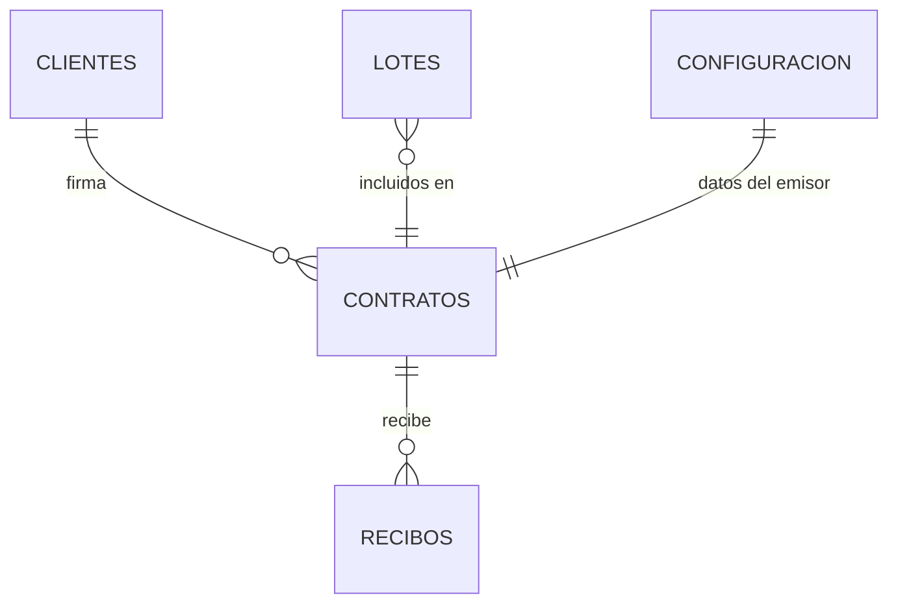

# Modelo de datos — MongoDB Atlas (v2, basado en documentos reales)

> Fuente de verdad del modelo. Actualizar en el mismo cambio que cualquier modelo Beanie o script de migración.
> Origen de los campos: `docs/ANALISIS-DOCUMENTOS.md`.
> Campos comunes en toda colección de negocio: `_id`, `creado_en`, `actualizado_en`, `creado_por`, `eliminado_en` (borrado lógico).
> Montos: `Decimal128`. Fechas-hora: UTC. Fechas simples (nacimiento, vencimiento): `date` guardada a medianoche UTC.

## Flujo del negocio

```
Cliente ──firma──▶ Promesa de compra-venta (1..N lotes)
                      ├─ enganche (fraccionado en 1..4 pagos)
                      ├─ plan de cuotas niveladas (generado, última cuota ajustada)
                      └─▶ Recibos de caja (enganche | cuota | abono a capital | otros)
                             └─▶ saldo del contrato actualizado en la misma transacción
```



## `configuracion` (un solo documento)
Datos del emisor que salen en los PDFs: `empresa` ("Inmobiliaria Estrada"; migración 0004), `proyecto` ('Lotificación "Tablon Campestre2"'; migración 0005), `cuentas_bancarias` [{banco, tipo, numero, titular}] (salen en la página 1 de la promesa), `direccion_oficinas`, `telefono`, `direccion_proyecto`, `lugar_pago`, `logo_archivo_id`, `representante_legal` {nombre, dpi}, `ciudad_recibos` ("Jalapa"), `reglas` {dias_gracia: 5, mora_pct_mensual: 5, abono_capital_minimo: 2000.00, arras_pct_precio: 20, arras_pct_pagado: 50}, `condiciones_generales_validadas` (bool). El texto legal de la página 2 **no** se guarda en la BD: vive en `backend/app/modules/configuracion/textos.py` (migración 0002 quitó la copia).

## `clientes`
```js
{
  nombres_apellidos, dpi /*13 dígitos, único*/, nit /*o "CF"*/, direccion, telefono, email,
  fecha_nacimiento, nacionalidad, estado_civil,
  num_dependientes, profesion_actividad,
  trabajo: { empresa, direccion, telefono, puesto, tiempo_trabajo, ingreso_mensual: Decimal128, otros_ingresos: Decimal128 }
}
```
La **edad no se guarda**: se calcula a la fecha de firma. Índices: `dpi` único parcial · texto (`nombres_apellidos`, `dpi`, `nit`).

## `lotes`
```js
{ lotificacion: "monaco" | "finca_el_ensueno" | "tablon_campestre2" | null,
  codigo: "36-B34" /*único por lotificación*/, area_m2: Decimal128, finca, folio, libro, libro_de: "Jalapa",
  estado: "disponible" | "reservado" | "vendido" }
```
Índices: (`lotificacion`, `codigo`) único · `estado`. `lotificacion: null` = lote registrado antes de poder elegirla.

**Lotificaciones** (catálogo fijo en `lotes/schemas.py` → `LOTIFICACIONES`, espejo en `frontend/src/lib/formato.ts`): `monaco` → LOTIFICACIÓN "MONACO", `finca_el_ensueno` → LOTIFICACIÓN "FINCA EL ENSUEÑO", `tablon_campestre2` → LOTIFICACIÓN "TABLON CAMPESTRE2". La promesa guarda la clave y sus PDFs (promesa, recibos, estado de cuenta) imprimen ese nombre; si es `null` (promesas anteriores) usan `configuracion.proyecto`.

> **Borrado lógico** (`contratos` y `recibos`): `eliminado_en` (fecha UTC) y `motivo_eliminacion`. Lo borrado no aparece en ninguna consulta de la API pero sigue en Atlas y en `auditoria` (acción `eliminar`). Borrar una promesa borra sus recibos y libera el lote.

## `contratos` (Promesa de Compra Venta)
```js
{
  numero: 184,                       // correlativo atómico; se imprime "00184"
  fecha_firma, 
  lotificacion: "monaco" | "finca_el_ensueno" | "tablon_campestre2" | null,  // obligatoria al crear
  cliente_id,
  lote_ids: [ObjectId],
  instantanea: { cliente: {...}, lotes: [{...}], emisor: {...}, condiciones_generales_version },
  conyuge_gestor: { nombres_apellidos, direccion, telefono, dpi, email, fecha_nacimiento, nacionalidad, profesion_actividad } | null,
  dependientes: [{ nombre, edad, dpi }],          // máx. 5
  condiciones: {
    precio_terreno, mejoras, total,               // total = precio + mejoras
    enganche, otros_descuentos, saldo_a_pagar,    // saldo = total − enganche − descuentos
    enganche_fraccionado: [{ fecha, monto }],     // Σ = enganche, máx. 4
    plazo_anios /* 1..4 */, numero_cuotas /* por defecto plazo×12, editable */,
    cuota_nivelada /* calculada, editable */, tasa_interes_anual_pct /* puede ser 0 */,
    fecha_primera_cuota, dia_pago_mensual,
    otras_condiciones: "texto libre"
  },
  plan_cuotas: [{ numero, mes /*"2025-10"*/, vencimiento, capital, interes, cuota,
                  pagado: Decimal128, estado: "pendiente"|"parcial"|"pagada" }],
  notario: { ciudad, fecha, nombre, representante } | null,
  total_pagado_capital, saldo_capital,
  estado: "vigente" | "cancelado_total" | "desistido" | "anulado",
  desistimiento: { fecha, penalidad, monto_devuelto, motivo } | null
}
```
Índices: `numero` único · `cliente_id` · `lote_ids` · `estado`.

## `recibos` (Recibo de Caja)
```js
{
  numero: 2540,                      // correlativo interno del recibo (atómico)
  numero_fel: "…" | null,            // OPCIONAL: nº de factura FEL emitida por SAT; texto libre, sin relación ni validación
  lugar: "Jalapa", fecha,
  contrato_id, cliente_id, lotificacion /* copiada de la promesa */, lotes_texto: "36-B34",
  concepto: "enganche" | "cuota" | "abono_capital" | "otros",
  cuota_numero: 9 | null, cuota_mes: "2025-10" | null,
  desglose: { capital, intereses, recargo_mora, abono_capital, otros },
  total,                              // = Σ desglose
  total_en_letras,                    // generado
  saldo_anterior, saldo_actual,       // saldo_actual = anterior − capital − abono_capital
  boletas: [{ numero: "88507709", cuenta: "110-018984-2" }],
  recibido_por: usuario_id,
  anulado: false, motivo_anulacion: null
}
```
Índices: `numero` único · (`contrato_id`, `fecha`) · `cliente_id`.
Registrar recibo = **transacción** {correlativo, insertar recibo, actualizar `plan_cuotas` y saldos del contrato, auditoría}. Anular revierte saldos; nunca se borra.

## `usuarios` (cuentas de Google autorizadas — ver ADR-003)
| Campo | Tipo | Notas |
|---|---|---|
| `correo` | string | minúsculas; **único** |
| `nombre`, `foto` | string | se actualizan desde Google en cada acceso |
| `rol` | `admin` \| `operador` \| `consulta` | `consulta` solo lee/descarga |
| `activo` | bool | desactivar revoca también las sesiones abiertas |
| `google_sub` | string \| null | id estable de Google; se fija en el 1.er acceso; **único parcial** (solo strings) |
| `ultimo_acceso`, `creado_en`, `actualizado_en` | datetime UTC | |

Sin contraseñas. Solo entran correos registrados aquí o listados en `ADMIN_CORREOS` (`.env`), que se crean/promueven como `admin`.

## Otras
- `contadores`: `{_id: "contrato", valor}`, `{_id: "recibo", valor}` (iniciar con el último número usado en papel).
- `auditoria`: `usuario` = correo de la sesión (o `"sistema"` en scripts); acciones nuevas `iniciar_sesion`, `inicio_sesion_rechazado`, `cerrar_sesion`, `autorizar_usuario`, `actualizar_usuario`.
- `archivos` — como en `ADR-002` / skill `mongodb` (archivos escaneados del contrato firmado se guardan en `storage/`).

## Historial de cambios del modelo

| Fecha | Script | Cambio |
|---|---|---|
| 2026-11-03 | — (colección nueva, índices los crea Beanie) | `usuarios` para el acceso con Google; `auditoria.usuario` guarda el correo real |
| 2026-10-20 | `0007_lotificacion_existentes_tablon` | Promesas, recibos y lotes anteriores a 0006 → `lotificacion: "tablon_campestre2"` |
| 2026-10-19 | `0006_lotes_por_lotificacion` | `lotificacion` en `contratos`, `recibos` y `lotes`; el índice único de `lotes` pasa de `codigo` a (`lotificacion`, `codigo`) |
| 2026-09-29 | — | Borrador v1 para MongoDB |
| 2026-09-30 | — | v2.3: `contratos.saldo_inicial` {saldo_capital, cuotas_pagadas, fecha_corte, nota} para clientes del papel; `contratos.total_pagado_enganche`; `plan_cuotas[].capital_pagado/interes_pagado` (reemplaza `pagado`); `recibos.desglose.enganche`; `recibos.plan_anterior` + `estado_contrato_anterior` (snapshot para anular exacto); `recibos.cliente_nombre` desnormalizado; número de recibo formateado a 6 dígitos |
| 2026-09-30 | — | v2.2 implementado: la instantánea del contrato se guarda directamente en `comprador` y `lote` (no bajo `instantanea`); `lotes` guarda `contrato_id`; `plan_cuotas[].saldo_despues`; colección `configuracion` con `clave: "principal"`; edad calculada, no guardada |
| 2026-09-30 | — | v2.1: plazo 1–4 años (cuotas = plazo×12 editable); `numero_fel` opcional sin relación; montos siempre capturados por el usuario |
| 2026-09-30 | — | v2: campos reales de la Promesa de Compra Venta y el Recibo de Caja; `pagos` → `recibos`; `configuracion` del emisor; plan de cuotas embebido |
